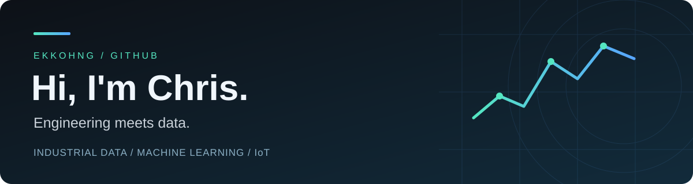

  

  
  

## Engineering curiosity. Practical exploration.

I'm Chris, **@Ekkohng**. My GitHub brings together interests in industrial data, machine learning, connected devices, and software tools for engineering.

I'm especially interested in the connection between physical systems and useful software: understanding equipment data, exploring predictive maintenance, and turning engineering information into something actionable.

### Areas I explore

  
  
  
  

| Focus | What interests me |
| :--- | :--- |
| Industrial intelligence | Predictive maintenance, condition monitoring, and time-series data |
| Applied machine learning | Exploring models, datasets, and practical engineering applications |
| IoT and embedded systems | Sensors, connected hardware, and the path from device to data |
| Engineering workflows | Data extraction, technical diagrams, and tools for energy applications |

### Explore my repository collection

These public repositories reflect topics I explore. The collection includes forks and learning resources; original authorship belongs to the respective projects.

- **[Predictive maintenance](https://github.com/Ekkohng/predictive-maintenance-using-machine-learning)** — machine learning in the context of equipment maintenance.
- **[Industrial ML datasets](https://github.com/Ekkohng/industrial-ml-datasets)** — a starting point for exploring industrial data.
- **[Piping and instrumentation diagram digitization](https://github.com/Ekkohng/digitization-of-piping-and-instrument-diagrams)** — engineering diagrams and digital workflows.
- **[ESP32 IoT development](https://github.com/Ekkohng/esp32-iot-devkit-get-started)** — connected-device exploration.

## GitHub activity

  

  

Activity widgets refresh through third-party services and may occasionally be unavailable. Explore my <a href="https://github.com/Ekkohng?tab=overview">GitHub overview</a> for native contribution details.

---

  <b>Interested in industrial data, IoT, or applied ML?</b> 
  Explore a repository and join the conversation in its public issues.

